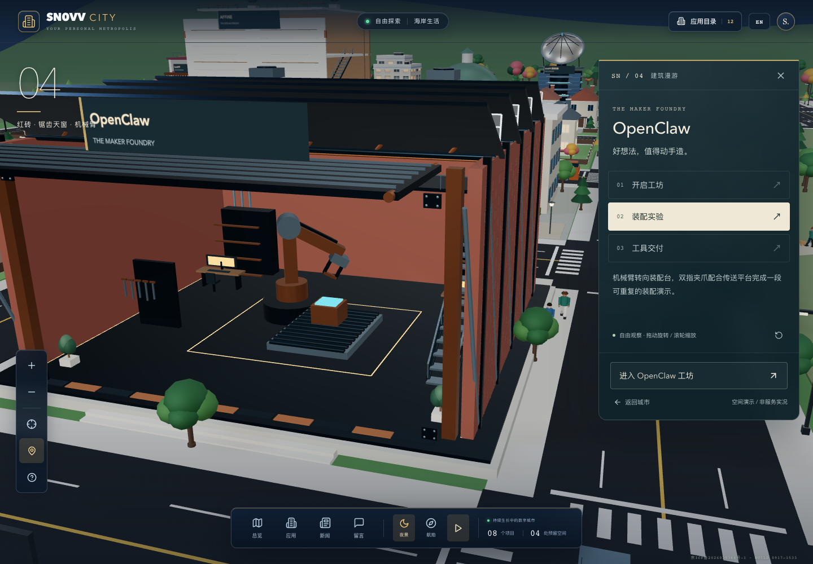
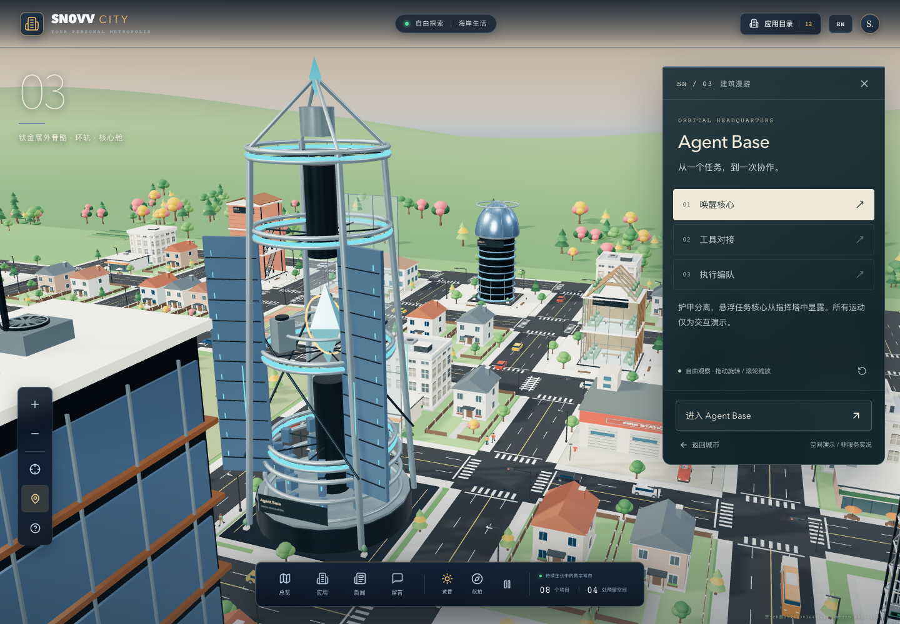
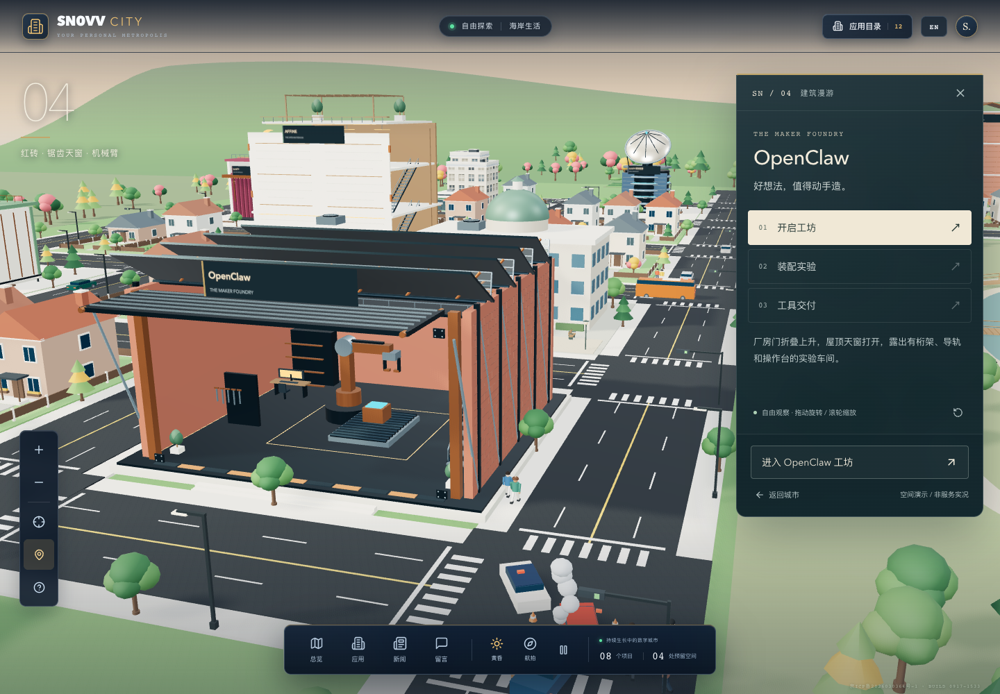
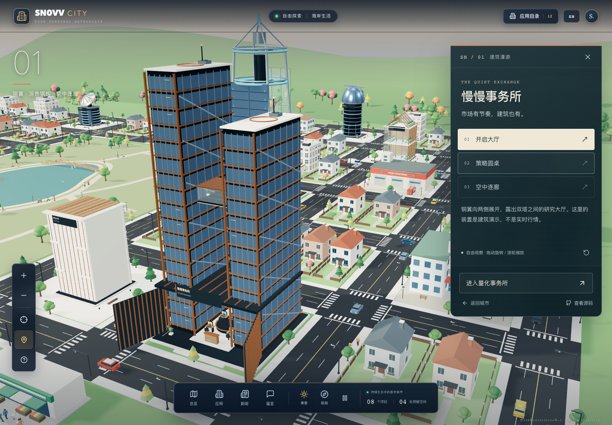
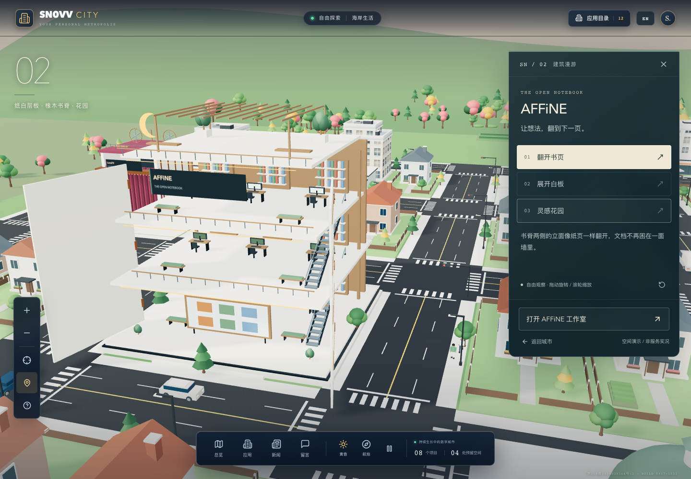
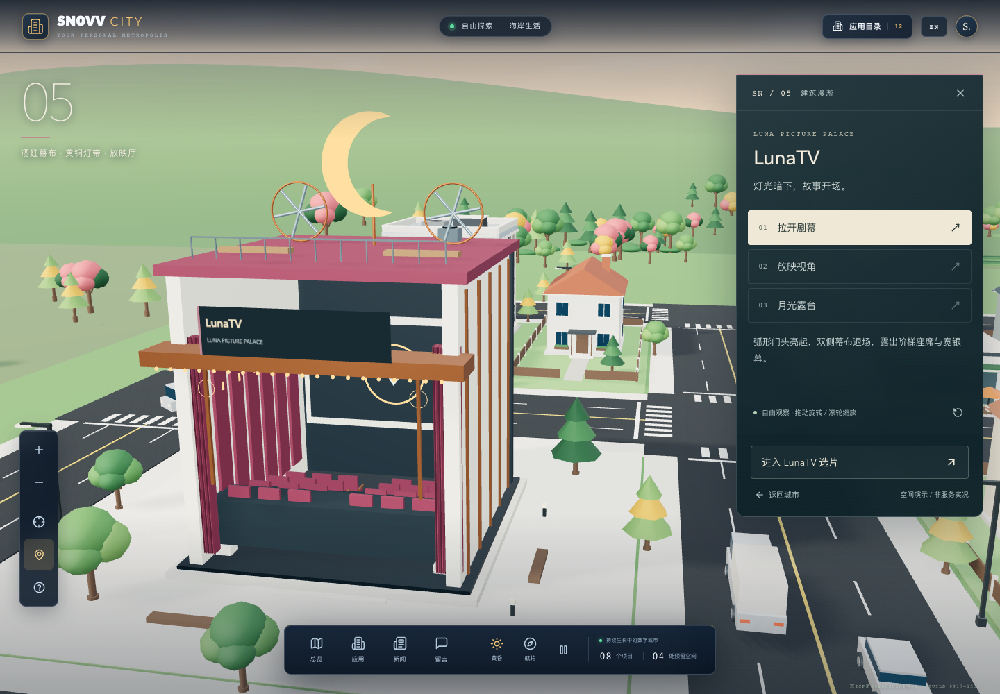
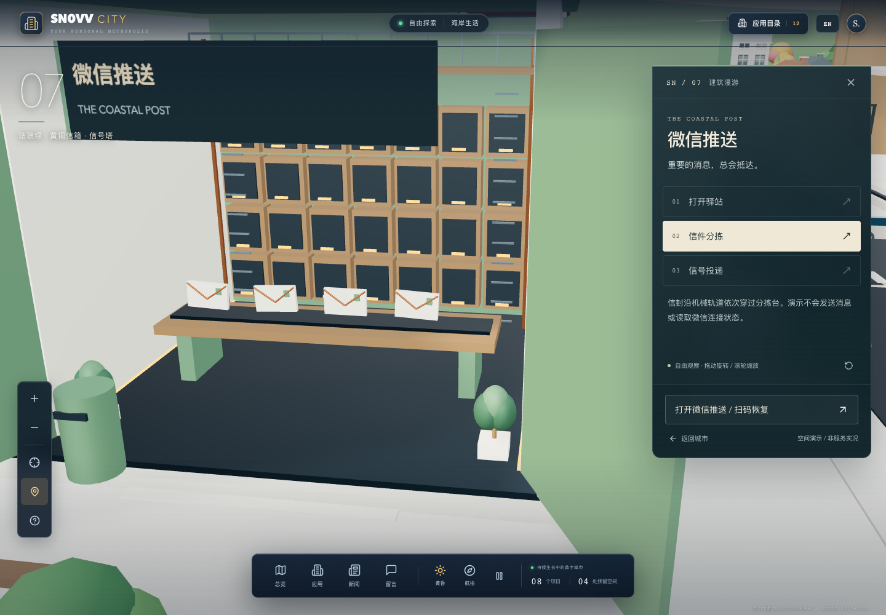
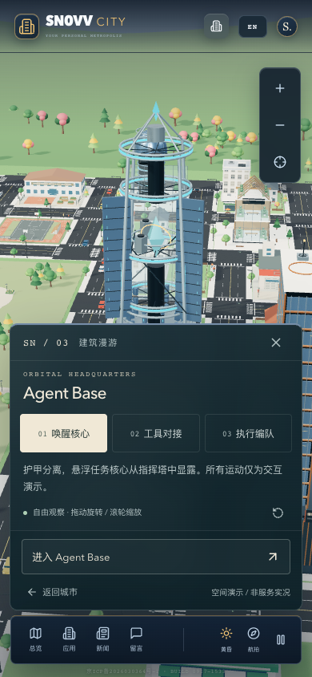
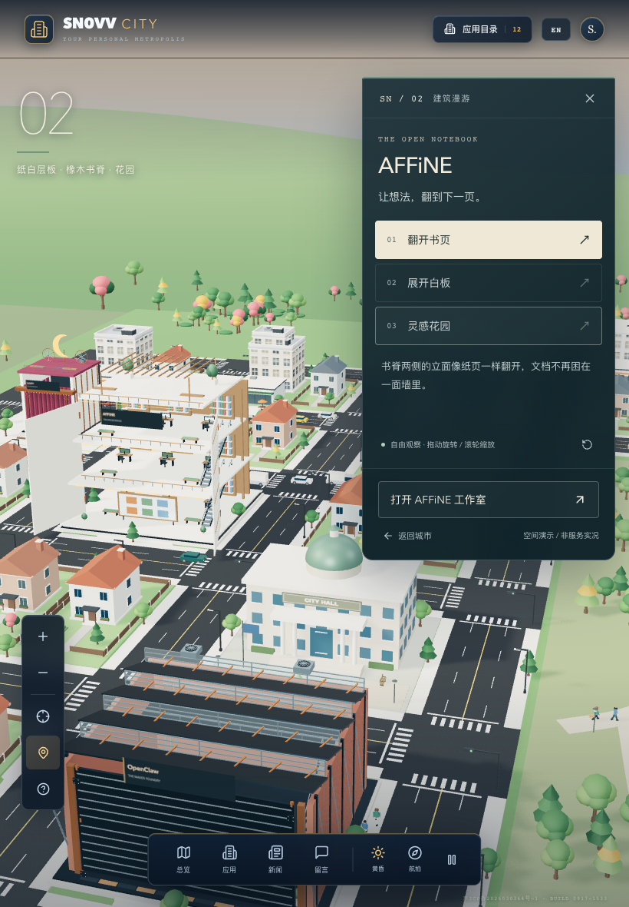

<div align="center">

# 🏙️ SN0VV CITY
### Next.js + React 19 + Three.js 沉浸式 3D 赛博城市自托管应用导航与数字地标矩阵

**100% 纯代码几何与着色器生成 · 零外部 3D 模型 (.gltf/.obj) · 零外部贴图 · 零外部字体 · 轻量秒开**

[](https://nextjs.org/)
[](https://react.dev/)
[](https://threejs.org/)
[](https://www.typescriptlang.org/)
[](LICENSE)

[✨ 核心亮点](#-核心亮点) · [📸 视觉图廊](#-视觉图廊) · [🏛️ 建筑漫游矩阵](#-建筑地标与漫游矩阵) · [🚀 快速开始](#-快速开始) · [🛠️ 接入自定义服务](#-接入与自定义应用) · [⚡ 性能架构](#-性能优化与工程架构)

<br/>



<p align="center"><em>▲ 赛博夜景模式俯瞰：中央生态湖泊、外露 Diagrid 钢桁架工坊、穿梭车流与动态霓虹光影</em></p>

</div>

---

## 📖 项目简介

**SN0VV CITY** 是一个将**私有化自托管微服务、私人知识库与开源项目导航**融入**高交互 3D 滨海数字城市**的沉浸式落地页系统（Landing Page）。

整个城市由**西岸老城**、**东湾城区**和**北部新城**三大片区组成，环抱连片的中央生态湖畔公园，向外延伸至金黄沙滩、棕榈树阵与集装箱货运码头。不同于传统借助庞大 `.gltf` / `.obj` 资产的 3D 网页，SN0VV CITY 的全部建筑、路网、机电、人群、浪潮与天空盒**均由 Three.js 纯代码过程式建模（Procedural Generation）**，零外部模型、零外部贴图与字体，兼备极高的视觉质感与毫秒级的轻量首屏体验。

> 🔒 **隐私与安全设计**：
> 本系统作为前端纯静态三维外壳，所有后台自托管应用、私有化工具及服务均通过标准化插槽挂载。对外展示的是纯粹的三维数字地标建筑语言与机械机构动画，不暴露任何私有内网拓扑与服务真实网络地址。

---

## ✨ 核心亮点

### 1. 🏙️ 100% 过程式 3D 滨海生态城市 (Procedural City)
- **纯代码建模**：所有摩天大楼、双塔、工坊、路桩、悬挑雨棚、岸吊与货轮均为数学几何生成。
- **生机盎然的城市生态**：动态街道车流、散步/交谈的 3D 人群生活系统、微波粼粼的沿海沙滩与码头。
- **实时平滑昼夜系统**：支持**黄昏暖金日落**与**赛博夜景霓虹**一键平滑切换，配合动态天空大气散射与闪烁星空着色器。

### 2. 🏢 12 栋独立建筑地标 & 机械结构动态展开 (Kinetic Architecture)
- 每一栋应用建筑都拥有独立的建筑设计语言与**三段式镜头深度探索**。
- **点击建筑镜头平滑拉近**：自动触发机械百叶开合、双折厂门打开、工业关节机械臂旋转装配、空中天桥伸展、全息投影片头、信标波纹等剧场级 3D 机械铰接动画。

### 3. 🔬 08号楼 · 技术剖面展馆 (Multi-Floor Archive Tower 3D)
专为长篇技术文档、知识库与独立 HTML 打造的旗舰级 3D 剖面展馆：
- **重型钢结构外骨骼**：四角工字钢巨柱、侧面/背面外露 Diagrid X-Bracing 交叉钢桁架、屋顶机电停机坪（带发光 `H` 标识、360° 旋转抛物面雷达天线、双组工业级旋转散热风机、倾角光伏阵列与航空信标塔）。
- **折叠展开机械立面**：拉近后四扇点支玻璃幕墙向两侧折角展开，顶部遮阳百叶翻转，当前楼层向前悬挑滑出，并自动伸出带玻璃护栏与立柱的 **3D 悬挑空中观景阳台 (Skywalk Balcony)**。
- **全透明 Warren 钢桁架外挂观光电梯**：
  - 楼顶透明机房内置 3D 永磁同步电机、双辐条曳引轮、6 根牵引钢缆与 **7 层叠片式配重块反向升降**。
  - 全景透明轿厢内置四角导靴滚轮、不锈钢扶手杆、选层操作盘 (COP)、3D 访客模型与门楣动态 LED 报站屏。
  - **电梯搜索直达**：输入关键字或使用鼠标滚轮滑动，电梯实时执行「关门 $\rightarrow$ 滑轮钢缆旋转 $\rightarrow$ 垂直升降 $\rightarrow$ 减速平层 $\rightarrow$ 轿厢与候梯厅双门联动开启」。
- **双层高精 3D 室内微缩沙盘**：
  - **1F · 智能体协同指挥中心**：八角指挥地台、10 联屏环形控制台、**三轴正交旋转陀螺仪万向节雕塑**、6 智能体节点舱、沿光导纤维穿梭的动态数据脉冲球、人体工学办公椅阵列与 42U 服务器机柜。
  - **2F · 算法微调与计算实验室**：由 36 颗悬浮冰蓝晶块组成的 **$3\times 4\times 3$ 预训练冻结权重晶格 $W_0$**、**$\Delta W = (\alpha/r) B \times A$ 低秩张量分解阵列**、中央旋转秩压缩能量环 $r$、穿梭梯度粒子流、阶梯教室终端与液冷算力机群。
- **空间全息 HUD**：无需跳出三维世界，在 3D 场景旁以透视角度无缝嵌入并深度体验独立技术文档与多媒体内容。

### 4. ⚡ 极致 WebGL 工程性能优化
- **实例化批次合并 (`THREE.InstancedMesh`)**：相同材质纯色表面跨楼合并，整座庞大城市的 Draw Calls 从 340+ 次锐降至平均约 130 次。
- **动态阴影按需节流**：阴影贴图以 10Hz 智能刷新，静止镜头直接复用楼牌投影。
- **高分屏渲染预算控制**：高分屏（Retina）画布渲染上限限制在约两百万像素，UI 保持原生矢量级锐利，帧间隔稳定在 33.3ms。
- **休眠机制**：标签页隐藏或离屏时自动暂停计算，杜绝后台发热与电量消耗。

### 5. 📱 全端适配与无障碍降级
- **全输入设备支持**：桌面端鼠标双键旋转/平移与滚轮缩放；移动端单指旋转、双指平移与捏合缩放。
- **多端响应式**：完美自适应桌面宽屏、折叠屏、平板横竖屏与各类手机屏幕。
- **无障碍与系统兼容**：原生遵循操作系统的 `prefers-reduced-motion` 减少动态偏好；在无 WebGL 硬件加速环境下自动平滑降级为卡片式导航。

---

## 📸 视觉图廊

<table align="center" width="100%">
  <tr>
    <td width="50%" align="center">
      
      <br/><b>03 智能体指挥塔 · 钛色外骨骼</b><br/><em>分离式重装护甲升起、任务核心舱与对接环</em>
    </td>
    <td width="50%" align="center">
      
      <br/><b>04 自动化装配工坊 · 工业锯齿厂房</b><br/><em>双折厂门展开、关节机械臂焊接与导轨小车</em>
    </td>
  </tr>
  <tr>
    <td width="50%" align="center">
      
      <br/><b>01 金融研究双塔 · 铜翼金融建筑</b><br/><em>开启研究大厅、策略圆桌与悬挑空中连廊</em>
    </td>
    <td width="50%" align="center">
      
      <br/><b>02 知识协作工坊 · 橡木书卷立面</b><br/><em>翻页立面联动、抽拉白板与屋顶露天阅读花园</em>
    </td>
  </tr>
  <tr>
    <td width="50%" align="center">
      
      <br/><b>05 沉浸式多媒体大厅 · 酒红黄铜剧场</b><br/><em>剧场帷幕升起、阶梯座席与几何全息片头</em>
    </td>
    <td width="50%" align="center">
      
      <br/><b>07 消息分拣驿站 · 珐琅绿消息枢纽</b><br/><em>折叠百叶窗、信件智能分拣滑轨与波纹脉冲信标</em>
    </td>
  </tr>
  <tr>
    <td width="50%" align="center">
      
      <br/><b>移动端竖屏 3D 交互与 HUD 适配</b><br/><em>流畅的单/双指触控手势与自适应控制台</em>
    </td>
    <td width="50%" align="center">
      
      <br/><b>平板端 / 折叠屏响应式排版</b><br/><em>自适应视口比例、非模态导览抽屉与无横向溢出</em>
    </td>
  </tr>
</table>

---

## 🏛️ 建筑地标与漫游矩阵

全城建筑提供标准化的插槽（Slot），每一栋均配备三段式镜头与独立机械铰接动画：

| 楼位编号 | 建筑形态与主题 | 建筑设计语言 | 专属机械机构与空间细节 |
| :---: | :--- | :--- | :--- |
| **01** | **金融分析空间** | 铜翼金融双塔 | 铜翼开启、策略圆桌、延伸式悬空玻璃连廊 |
| **02** | **知识协作工坊** | 橡木书脊与纸白层板 | 立面如书页展开、抽拉式白板协作台、屋顶阅读花园 |
| **03** | **智能体指挥中心** | 钛色外骨骼指挥塔 | 分离式重型护甲升起、中央任务核心、工具对接环与执行舱 |
| **04** | **自动化工程车间** | 红砖锯齿顶装配工坊 | 双折折叠厂门展开、六轴工业机械臂装配、导轨传送小车 |
| **05** | **多媒体视听大厅** | 酒红与黄铜剧场 | 红色开幕帷幕收缩升起、弧形阶梯观众席、几何全息片头、月光露台 |
| **06** | **数据观测基站** | 信号观测站 | 信号接收模块向外展开、抛物面天线旋转俯仰扫描、对准信号透镜 |
| **07** | **消息分发驿站** | 珐琅绿消息驿站 | 机械折叠百叶窗、信件智能分拣滑轨、屋顶消息波纹发射信标 |
| **08** | **技术剖面手稿馆** | 晶格折叠重钢大厦 | 四扇折叠幕墙、伸缩观景阳台、Warren 电梯升降、双层 3D 室内微缩沙盘 |
| **09–12** | **预留创想楼群** | 光庭、折阁、天穹台、生长院 | 旋转遮阳格栅、陶土折板呼吸、分瓣张拉穹顶、生态温室天窗扇 |

---

## 🚀 快速开始

### 运行环境
- **Node.js**: `18.18+` 或 `20+` / `22+`
- **包管理器**: `npm` / `pnpm` / `yarn`

### 1. 克隆代码与安装依赖
```bash
git clone https://github.com/SN0VV0511/web-luodi.git
cd web-luodi
npm ci
```

### 2. 配置环境变量
```bash
cp .env.example .env.local
```
编辑 `.env.local`，填入你自己微服务的公开访问网址（若暂时留空，界面会自动显示“入口待连接”，不产生任何错误跳转）。

### 3. 本地启动开发
```bash
npm run dev
```
打开浏览器访问 [http://localhost:3000](http://localhost:3000)，体验实时 3D 城市漫游。

### 4. 质量检验与编译构建
```bash
# 执行单元测试
npm test

# 执行 TypeScript 类型检查
npm run typecheck

# 静态导出生产构建
npm run build
```
构建产物将完整输出至 `out/` 目录。

### 5. 预览生产构建产物
```bash
python3 -m http.server 3101 --bind 127.0.0.1 --directory out
```
浏览器访问 `http://127.0.0.1:3101` 即可预览完全静态导出的站点。

---

## 🛠️ 接入与自定义应用

无需编写或修改任何复杂的三维 Three.js 着色器代码，只需编辑 [`lib/city-content.ts`](lib/city-content.ts) 中的 `officeTenants`，即可将你自己的私有应用挂载到指定楼宇：

```typescript
// lib/city-content.ts
export const officeTenants: Partial<Record<`slot-${number}`, Omit<CityPlace, "id" | "number" | "vacant">>> = {
  // 入驻 05 号楼
  "slot-5": {
    name: "我的影音服务",
    category: { zh: "流媒体影院", en: "STREAMING THEATER" },
    description: { 
      zh: "家庭影视流媒体与影音控制中心。", 
      en: "Private media streaming center." 
    },
    color: "#8a9e8b",
    href: "https://media.example.com", // 替换为你自己的服务入口
  },
  // 入驻 09 号预留楼
  "slot-9": {
    name: "AI 代码实验室",
    category: { zh: "智能研发", en: "AI LAB" },
    description: { 
      zh: "全自动代码研发流水线。", 
      en: "Automated AI code generation pipeline." 
    },
    color: "#6ba2c8",
    href: "https://lab.example.com",
  },
};
```

> **安全与环境变量提示**：
> `NEXT_PUBLIC_*` 变量在 Next.js 构建时编译注入前端静态包。禁止在前端环境变量中放置任何私钥、Token 或内网未授权端口。修改配置后重新执行 `npm run build` 即可刷新静态页面。

---

## ⚡ 性能优化与工程架构

### 核心目录设计
```text
web-luodi/
├── app/                       # Next.js App Router 布局与样式
│   ├── globals.css            # 全局响应式排版与空间 HUD 样式
│   └── landmarks.css          # 建筑漫游非模态导览抽屉样式
├── components/                # React 交互组件
│   ├── city-scene.tsx         # Three.js 主画布、渲染循环、相机飞行与交互
│   ├── landing-page.tsx       # 页面外壳、控制工具栏、小地图与目录
│   └── building-experience-panel.tsx # 建筑机构导览分步控制台
├── lib/                       # 核心业务与 3D 过程式构建系统
│   ├── city-content.ts        # 楼宇租户、元数据统一配置源
│   ├── city-world.ts          # 城市主地形、道路网络与楼群生成
│   ├── city-map.ts            # 地块划分与三维空间网格管理
│   ├── landmark-kit.ts        # 共享机械构件、批次实例化与资源管理
│   ├── landmark-builders.ts   # 01~07 核心地标建筑的机械结构实现
│   ├── landmark-reserves.ts   # 09~12 预留楼宇的机械艺术结构实现
│   ├── archive-tower-3d.ts    # 08 号技术剖面馆 3D 建筑总成与电梯状态机
│   ├── archive-tower-structure.ts # 08 号楼重型钢外骨骼、雨棚与停机坪
│   └── archive-tower-interiors.ts # 08 号楼双层 3D 微缩沙盘与张量模型
├── public/                    # 静态资源与独立手稿嵌入
└── scripts/                   # 自动化质量与性能回归套件
    ├── check-city.py          # 真实 WebGL、手势、焦点与降级自动化回归
    ├── check-landmarks.py     # 11 栋建筑漫游 66 个视角的端到端测试
    └── profile-city.py        # 帧率、Draw Calls、长任务性能基准采样
```

### 性能基准与实测
通过执行 `python3 scripts/profile-city.py --url http://127.0.0.1:3101 --runs 3 --check` 进行真实浏览器性能评测：
- **Draw Calls**：从优化前的每帧 337 次合并压降至**平均约 137 次**；
- **渲染帧间隔**：帧间隔中位数稳定在 **33.3ms（稳定 30fps / 60fps 体验）**；
- **资源占用**：零大型二进制网格文件下载，初始网络负载极低，移动端与轻薄本均能顺畅交互。

---

## 🧪 自动化测试与质量保障

项目维护了覆盖全平台场景的严苛测试套件：
1. **单元测试与逻辑验证**：
   ```bash
   npm test
   ```
   包含配置边界、机构收敛、实例拾取、关闭态批次替换和 WebGL 资源正确释放的测试。
2. **端到端浏览器回归**（基于 Playwright）：
   ```bash
   python3 scripts/check-city.py
   python3 scripts/check-landmarks.py --url http://127.0.0.1:3101
   ```
   覆盖桌面与手机端各章节相对镜头、昼夜切换、动画暂停、平板与折叠屏横竖屏排版、系统减少动态偏好以及无 WebGL 降级。

---

## 🤝 贡献与参与

欢迎提交 Issue、提出新建筑概念或发起 Pull Request！
1. Fork 本项目
2. 创建特性分支：`git checkout -b feat/new-landmark`
3. 提交更改：`git commit -m 'feat: add new kinetic structure'`
4. 推送分支：`git push origin feat/new-landmark`
5. 发起 Pull Request

---

## 📄 开源许可证

本项目基于 [MIT License](LICENSE) 开源。欢迎自由使用、改造并构建属于你的数字 3D 城市！

<div align="center">
  <sub>Built with ❤️ by <a href="https://github.com/SN0VV0511">SN0VV</a> · Designed for Self-Hosters & 3D Web Enthusiasts</sub>
</div>
